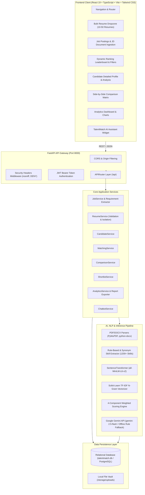

# TECHNICAL DOCUMENTATION — TALENTMATCH AI

**Platform:** TalentMatch AI — Enterprise AI-Powered Resume Matching & Candidate Ranking Platform  
**Target Organization:** AVOM Consultants  
**Architecture Classification:** Decoupled Client-Server Micro-Monolith (FastAPI + React 19 + TypeScript)  
**Document Version:** 1.0.0 Production  
**Date:** November 20, 2026  

---

## 1. System Architecture Overview

TalentMatch AI is engineered as an enterprise-grade recruitment intelligence platform that connects structured applicant tracking with transparent, explainable natural language processing and semantic vector matching.

---

## 2. Frontend & Backend Communication

1. **Protocol:** HTTP/1.1 RESTful APIs with JSON payloads and multipart/form-data for file uploads.
2. **Authentication:** Bearer token headers via `Authorization: Bearer <access_token>`.
3. **HTTP Client:** Axios client instance (`apiClient`) configured with base URL, timeout limits (30s), credentials, and automated 401 error interceptors.
4. **Error Handling:** Standardized FastAPI error envelope `{"detail": "Error explanation"}` rendered as contextual notifications on the frontend.
5. **State Management:** React hooks (`useState`, `useEffect`, `useCallback`) alongside Context API (`AuthContext`) for lightweight, predictable state transitions.

---

## 3. Resume Ingestion & Parsing Workflow

The resume ingestion subsystem in `backend/app/parsers/` operates with defensive per-file isolation:

1. **Multi-File Upload:** Ingests 1 to 50 files simultaneously via `POST /api/resumes/upload`.
2. **Format & Magic Header Verification:**
   - PDF files are verified against `%PDF-` magic bytes. Executables with spoofed `.pdf` extensions (starting with `MZ`) are rejected immediately.
   - DOCX files are verified against PK zip container headers (`PK\x03\x04`).
3. **Text Extraction:**
   - **PDF:** Extracted with PyMuPDF (`fitz`), with an automated fallback to `pypdf`. Detects password-encrypted files and reports scanned images requiring OCR.
   - **DOCX:** Extracted with `python-docx`, traversing document paragraphs and tabular grid structures.
   - **TXT:** Direct UTF-8 stream decoding.
4. **Information Extraction (`ResumeParser`):**
   - **Candidate Name:** Identifies candidate headers from top lines using pattern recognition and filters out resume keyword noise.
   - **Contact Data:** Regular expressions extract RFC 5322 email addresses and international/North American phone numbers.
   - **Work Experience:** Identifies explicit experience declarations (e.g., "5+ years") and chronologically parses employment date ranges, merging overlapping intervals to prevent double-counting parallel roles.
   - **Education:** Identifies degrees (Ph.D., Master's, Bachelor's, Associate's), institutions, and graduation years.
   - **Skills:** Categorizes technical capabilities across languages, frameworks, databases, and DevOps tools.
   - **Parsing Confidence:** Dynamically scored from 0.0 to 1.0 based on structural completeness.

---

## 4. Job Description Management Workflow

1. **Paste or Upload:** Recruiters can input job criteria by pasting raw text or uploading documents (.PDF, .DOCX, .TXT) via `POST /api/jobs/upload-jd`.
2. **NLP Extraction:** Automatically resolves job title, hiring company, location, minimum experience requirements, education requirements, and categorizes competencies into `mandatory` (top 5 essential skills) and `preferred` qualifications.
3. **Recruiter Review & Edit:** Form fields allow recruiters to review, adjust, add, or remove required skills before saving.
4. **Database Persistence:** Persisted in `jobs` and `job_requirements` relational tables.

---

## 5. NLP Methodology & Embedding Generation

1. **Taxonomy & Synonym Dictionary:** 
   Contains over 1,200 precompiled software engineering, cloud, data science, and web development skills (`backend/app/ai_engine/skill_dictionary.py`). Supports synonyms and common acronyms (e.g., "k8s" $\to$ "Kubernetes", "postgres" $\to$ "PostgreSQL", "js" $\to$ "JavaScript").
2. **Semantic Vector Embeddings:**
   - Utilizes `sentence-transformers/all-MiniLM-L6-v2` (384-dimensional dense vectors).
   - Fast initialization via local cache (`local_files_only=True`) to eliminate startup network latency.
   - Generates contextual embeddings for job requirements and candidate profiles, stripped of protected demographic markers (names, gender, contact details) to prevent demographic bias.
3. **Cosine Similarity:**
   Computes the normalized angular distance between candidate vectors and job requirement vectors:
   $$\text{Cosine Similarity} = \frac{\mathbf{u} \cdot \mathbf{v}}{\|\mathbf{u}\|_2 \|\mathbf{v}\|_2}$$
   Scores are mapped from $[-1, 1]$ into a $[0.0, 1.0]$ range.
4. **Zero-Dependency Fallback:**
   If PyTorch or SentenceTransformers is unavailable, an automated Scikit-Learn TF-IDF N-Gram Vectorizer with sub-linear term frequency provides robust, offline semantic similarity.

---

## 6. Explainable Weighted Scoring Engine

The scoring engine implements a reproducible 4-component model totaling 100 points:

| Component | Weight | Max Points | Evaluation Logic |
| :--- | :---: | :---: | :--- |
| **Technical Skill Match** | 40% | 40.0 pts | Mandatory skills weighted 2x vs preferred skills 1x. Exact match gives 100% credit, related skill gives 60% credit. Missing mandatory skills reduce score transparently. |
| **Semantic Similarity** | 30% | 30.0 pts | Dense vector cosine similarity comparing candidate profile context against job requirements. |
| **Relevant Experience** | 20% | 20.0 pts | Evaluates candidate's verified non-overlapping experience against job minimum. Meeting minimum yields 18 pts, surplus yields up to 20 pts, deficit scores proportionally. |
| **Education & Degree** | 10% | 10.0 pts | Evaluates degree alignment (Ph.D. = 10, Master's = 9.5-10, Bachelor's = 8.5-10, other degrees = 7.5, not specified = 6.0). |

---

## 7. Security Architecture & Ethical AI Controls

1. **SQL Injection Mitigation:** 100% parameterized queries via SQLAlchemy 2.0 ORM.
2. **Cross-Site Scripting (XSS):** React JSX default sanitization prevents inline script injection.
3. **HTTP Security Headers:**
   - `X-Content-Type-Options: nosniff`
   - `X-Frame-Options: DENY`
   - `X-XSS-Protection: 1; mode=block`
   - `Referrer-Policy: strict-origin-when-cross-origin`
4. **File Upload Security:** Isolated temporary storage, strict extension validation, magic-byte inspection, file size caps (15MB), and immediate cleanup of temporary files.
5. **Role-Based Access Control:** JWT Bearer tokens signed with HS256 algorithm and enforced via FastAPI dependencies (`get_current_user`).
6. **Ethical AI & Compliance:**
   - Personal names, emails, phone numbers, and demographic indicators are excluded from the semantic matching embedding target.
   - Scoring relies strictly on technical skills, verified work duration, education, and domain alignment.
   - The platform acts as a decision-support tool for human recruiters; automated rejection or hiring decisions are explicitly disabled.

---

## 8. Database Architecture & Schema Integrity

All models inherit from SQLAlchemy `Base` with foreign key cascades:
- `users`: User identity, password hash, role.
- `jobs`: Job posting, title, experience requirement, status.
- `job_requirements`: Normalized skill requirements with category (`mandatory`, `preferred`).
- `candidates`: Candidate identity, total experience, extracted profile JSON.
- `candidate_skills`: Normalized candidate skills with proficiency and source.
- `resumes`: Original filename, stored filename, file size, raw text, parsing status.
- `matching_analyses`: Overall score, 4 component sub-scores, matched/missing skills, explanation JSON.
- `score_breakdowns`: Granular score components for auditability.
- `shortlists`: Job-candidate shortlist status tracking.
- `recruiter_notes`: Collaborative recruiter feedback.
- `notifications`: System alerts and processing updates.
- `activity_logs`: Complete audit trail of recruiter actions.
