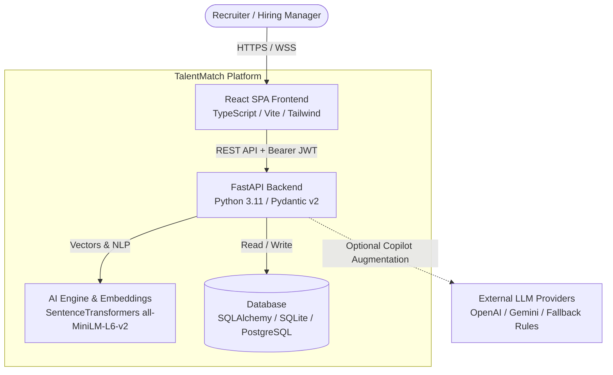
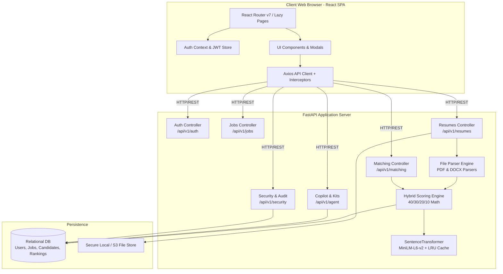
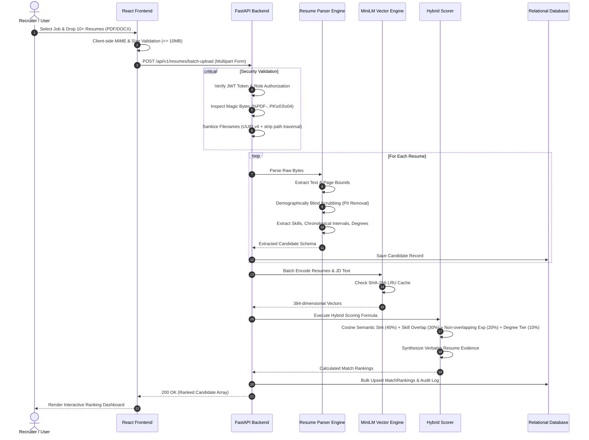
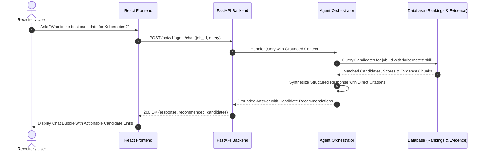

# TalentMatch.ai — System Architecture & Design Specification

## 1. High-Level Architecture Overview
TalentMatch.ai is built on a **modern decoupled client-server architecture**:
- **Presentation Layer**: React 19 Single Page Application (SPA) with TypeScript, Vite 6, Tailwind CSS v4, Lucide Icons, and Recharts. Built with route-based code-splitting and responsive layout for web and mobile viewports.
- **Application & API Layer**: FastAPI (Python 3.11+) asynchronous REST framework offering high concurrency, Pydantic v2 data validation, and automated OpenAPI documentation.
- **Intelligence Layer**: On-premise / local Neural Embeddings (`sentence-transformers/all-MiniLM-L6-v2`), taxonomic skill dictionary, regex-based chronological parser, and multi-agent task orchestrator.
- **Persistence Layer**: SQLAlchemy ORM with SQLite for development / single-node deployment and native PostgreSQL compatibility for enterprise production.

---

## 2. Mermaid System Context Diagram (C4 Level 1)

---

## 3. Mermaid Component Architecture (C4 Level 2)

---

## 4. Sequence Diagram: Batch Resume Ingestion & Neural Matching

---

## 5. Sequence Diagram: AI Recruitment Copilot

---

## 6. Technology Stack Rationale

| Layer | Technology | Decision Rationale |
| :--- | :--- | :--- |
| **Frontend** | React 19 + TypeScript + Vite | Industry standard component architecture, instantaneous HMR, strict type safety, zero compile bloat. |
| **Styling** | Tailwind CSS v4 | Utility-first, zero runtime overhead, responsive utility classes for dark/light theme consistency. |
| **Backend** | FastAPI + Pydantic v2 | Python async I/O performance rivaling Node.js, automatic OpenAPI docs generation, strict schema validation. |
| **ML Engine** | PyTorch + SentenceTransformers | Local, deterministic execution of `all-MiniLM-L6-v2`; zero API bills, zero network latency, 384-d semantic precision. |
| **Database** | SQLAlchemy 2.0 + SQLite/Postgres | Clean migration path from lightweight local development to distributed enterprise PostgreSQL databases. |
| **Security** | PyJWT + PassLib (Bcrypt) + File Magic | Cryptographically sound authentication, rate limiting, and defensive file header inspection. |
