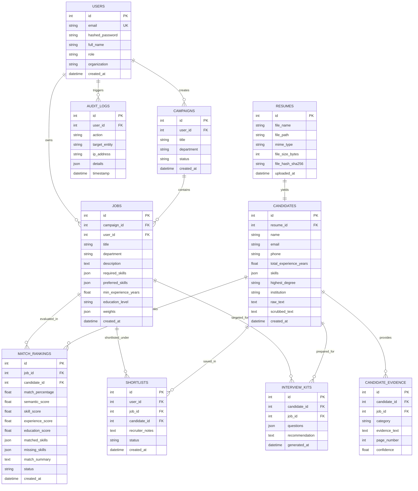

# TalentMatch.ai — Database Architecture & Schema Specification

## 1. Overview & Storage Strategy
TalentMatch.ai utilizes an enterprise relational schema managed by **SQLAlchemy 2.0 ORM**.
- **Development & Single-Node**: SQLite 3 with WAL (Write-Ahead Logging) mode enabled for high-concurrency concurrent reads.
- **Cloud & High-Availability**: Native PostgreSQL 15+ compatible with connection pooling (`pool_size=20`, `max_overflow=10`).
- **Data Protection**: Strict cascading deletes, foreign key referential integrity, and soft-delete capabilities for GDPR compliance.

---

## 2. Mermaid Entity-Relationship Diagram (ERD)

---

## 3. Detailed Table Definitions

### Table: `users`
| Column | Type | Constraints | Description |
| :--- | :--- | :--- | :--- |
| `id` | Integer | Primary Key, Auto-increment | Unique user identifier |
| `email` | String(255) | Unique, Indexed, Not Null | Work email address |
| `hashed_password` | String(255) | Not Null | Bcrypt hashed password (12 rounds) |
| `full_name` | String(255) | Not Null | Full recruiter/admin name |
| `role` | String(50) | Not Null, Default 'recruiter' | Role: 'recruiter', 'admin', 'auditor' |
| `organization` | String(255) | Nullable | Tenant / Employer name |
| `created_at` | DateTime | Not Null, Default UTC now | Registration timestamp |

### Table: `jobs`
| Column | Type | Constraints | Description |
| :--- | :--- | :--- | :--- |
| `id` | Integer | Primary Key, Auto-increment | Requisition ID |
| `campaign_id` | Integer | Foreign Key (`campaigns.id`), Nullable | Optional parent campaign |
| `user_id` | Integer | Foreign Key (`users.id`), Not Null | Requisition creator |
| `title` | String(255) | Indexed, Not Null | Job title (e.g. Senior Backend Engineer) |
| `department` | String(100) | Indexed, Not Null | Department / Business Unit |
| `description` | Text | Not Null | Full text of job description |
| `required_skills` | JSON | Not Null, Default '[]' | Mandatory skill list |
| `preferred_skills` | JSON | Not Null, Default '[]' | Nice-to-have skill list |
| `min_experience_years` | Float | Not Null, Default 0.0 | Minimum required years |
| `education_level` | String(100) | Default 'Bachelor' | Required degree tier |
| `weights` | JSON | Nullable | Custom scoring weights override |
| `created_at` | DateTime | Not Null, Default UTC now | Creation timestamp |

### Table: `candidates`
| Column | Type | Constraints | Description |
| :--- | :--- | :--- | :--- |
| `id` | Integer | Primary Key, Auto-increment | Candidate ID |
| `resume_id` | Integer | Foreign Key (`resumes.id`), Nullable | Reference to raw file record |
| `name` | String(255) | Indexed, Not Null | Candidate full name |
| `email` | String(255) | Indexed, Nullable | Contact email |
| `phone` | String(50) | Nullable | Contact phone number |
| `total_experience_years`| Float | Indexed, Not Null, Default 0.0 | Verified non-overlapping years |
| `skills` | JSON | Not Null, Default '[]' | Extracted & normalized skills |
| `highest_degree` | String(100) | Default 'None' | Highest educational attainment |
| `institution` | String(255) | Nullable | University or college name |
| `raw_text` | Text | Nullable | Full extracted text from PDF/DOCX |
| `scrubbed_text` | Text | Nullable | PII-blinded text for neutral matching |
| `created_at` | DateTime | Not Null, Default UTC now | Profile extraction timestamp |

### Table: `match_rankings`
| Column | Type | Constraints | Description |
| :--- | :--- | :--- | :--- |
| `id` | Integer | Primary Key, Auto-increment | Match record ID |
| `job_id` | Integer | Foreign Key (`jobs.id`), Indexed | Associated job requisition |
| `candidate_id` | Integer | Foreign Key (`candidates.id`), Indexed | Associated candidate |
| `match_percentage` | Float | Indexed, Not Null | Composite final score (0–100%) |
| `semantic_score` | Float | Not Null | MiniLM cosine similarity (0–100%) |
| `skill_score` | Float | Not Null | Taxonomic skill overlap (0–100%) |
| `experience_score` | Float | Not Null | Calibrated experience score (0–100%) |
| `education_score` | Float | Not Null | Degree hierarchy score (0–100%) |
| `matched_skills` | JSON | Not Null, Default '[]' | Overlapping skills list |
| `missing_skills` | JSON | Not Null, Default '[]' | Lacking mandatory skills list |
| `match_summary` | Text | Nullable | Natural language explanation |
| `status` | String(50) | Default 'Screened' | 'Screened', 'Shortlisted', 'Rejected' |
| `created_at` | DateTime | Not Null, Default UTC now | Evaluation timestamp |

---

## 4. Indexing & Query Optimization Strategy
To guarantee sub-second dashboard rendering and instant candidate sorting across 10,000+ records:
1. **Composite Index `idx_match_job_score`**: `(job_id, match_percentage DESC)` enables instantaneous pagination and ranking retrieval without sorting overhead.
2. **Composite Index `idx_candidate_skills`**: Indexed candidate skills via JSON path (or Gin index in PostgreSQL) for instant boolean skill filtering.
3. **Index `idx_audit_timestamp`**: `(timestamp DESC)` for high-velocity security log tailing and compliance audits.

---

## 5. Data Retention & GDPR "Right to be Forgotten"
TalentMatch.ai supports programmatic compliance with GDPR Article 17:
- Calling `DELETE /api/v1/candidates/{id}` removes candidate personal data, extracted resume text, match rankings, and stored resume file binaries atomically in a single transaction.
- An immutable audit trail entry is generated recording the anonymized deletion event (`"Candidate ID #482 deleted by user #12"`).
