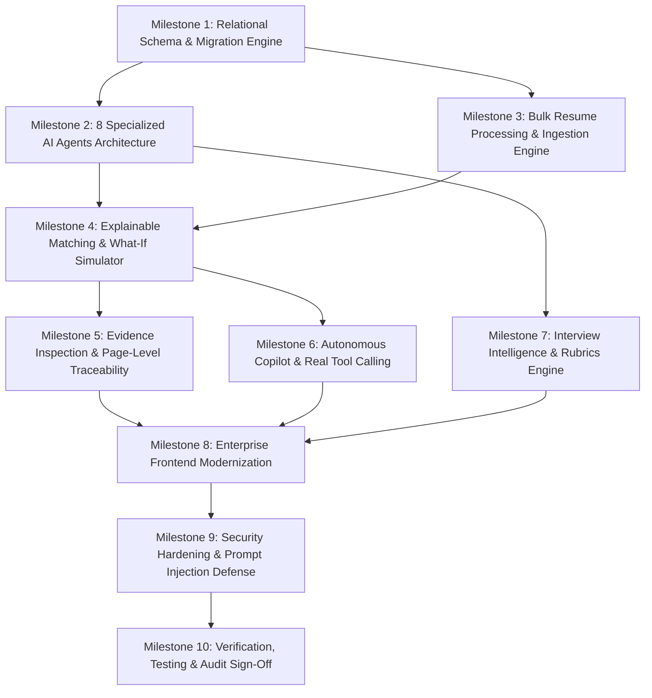

# TalentMatch.ai — Enterprise Implementation Roadmap
**Platform:** Agentic AI Recruitment Intelligence Platform  
**Target Architecture:** Decoupled React 19 + TypeScript Frontend, FastAPI Python 3.12 Backend, Multi-Agent AI Orchestration, SQLite/PostgreSQL Database  
**Author:** Principal AI Architect & Engineering Lead  
**Status:** ACTIVE IMPLEMENTATION PLAN  

---

## 1. Architectural Principles

1. **Deterministic Resilience:** The platform must function with 100% reliability whether an external LLM API is available, rate-limited, or completely offline. Deep heuristic fallback engines must guarantee zero crashes.
2. **Explainability First:** No match score may be generated without concrete supporting evidence, category breakdowns, and uncertainty indicators. Match scores are never treated as probabilities of job success.
3. **Strict Human Oversight:** High-stakes recruitment decisions require human recruiter confirmation. What-if analyses and criteria edits require review before committing changes to candidate records.
4. **Zero Data Destruction:** Existing user accounts, candidate profiles, and historical match data must be preserved through non-destructive database migrations and automated backups.

---

## 2. Milestone Breakdown & Dependencies

---

## 3. Detailed Milestones & Acceptance Criteria

### Milestone 1: Relational Schema & Migration Engine
- **Objectives:**
  - Create non-destructive database schema additions for:
    - `Campaign` (recruitment campaigns with target roles, departments, timelines, assigned recruiters).
    - `EvaluationRun` (versioned history of evaluation batches, criteria snapshots, weight settings).
    - `EvidenceReference` (criterion, snippet, page number, confidence, evidence classification).
    - `InterviewKit` (candidate-specific structured questions, rubrics, indicators).
    - `AgentExecution` & `AgentEvent` (agent task logs, durations, token counts, status).
- **Dependencies:** `backend/app/models/all_models.py`, `backend/app/database/session.py`.
- **Acceptance Criteria:**
  - Database schema evolves without data loss for existing 13 users, 19 jobs, 98 candidates.
  - Safe migration script verifies existing tables and adds missing columns/tables idempotently.

### Milestone 2: 8 Specialized AI Agents Architecture
- **Objectives:**
  - Implement 8 discrete, modular, typed AI agents under `app/ai_engine/agents/`:
    1. `JobDescriptionAgent`: Extracts title, seniority, mandatory vs preferred skills, responsibilities, detects ambiguities.
    2. `ResumeIntelligenceAgent`: Parses PDF/DOCX/TXT into structured profiles with page references, identifies incomplete sections.
    3. `TechnicalSkillsAgent`: Classifies skills into (Explicit, Project-Demonstrated, Professionally-Demonstrated, Weakly-Inferred, Not Found).
    4. `ExperienceEvaluationAgent`: Analyzes career trajectory, internships, projects, freshers fairly without penalizing lack of tenure.
    5. `CandidateMatchingAgent`: Calculates transparent scores against configurable weights (skills, projects, experience, education).
    6. `CandidateComparisonAgent`: Compares 2–4 candidates, highlights strengths, gaps, consensus, and agent disagreements.
    7. `InterviewIntelligenceAgent`: Generates candidate-tailored technical, coding, project, and claim-verification questions.
    8. `RecruiterCopilotAgent`: Executes real database tools (search, filter, compare, export, generate kits) with confirmation gates.
- **Dependencies:** Pydantic schemas, `LLMService`, `SkillExtractor`, `EmbeddingService`.
- **Acceptance Criteria:**
  - Every agent implements an isolated `execute()` method with structured input and output schemas.
  - Every agent includes automated timeout protection and heuristic fallback when LLM is unavailable.

### Milestone 3: Bulk Resume Processing & Ingestion Engine
- **Objectives:**
  - Asynchronous background worker queue for processing batches of 10 to 1,000 resumes.
  - Real-time status reporting per file: `uploaded` $\to$ `queued` $\to$ `parsing` $\to$ `evaluated` $\to$ `completed` / `failed`.
  - Hash-based duplicate detection to prevent redundant parsing and compute expenditure.
  - Detailed processing batch summary (total, success, failed, duplicate, pending).
- **Dependencies:** `app/services/resume_service.py`, `app/api/resumes.py`.
- **Acceptance Criteria:**
  - Batches of 50+ resumes ingest without blocking the main FastAPI event loop.
  - Failed or corrupted files report exact error messages without crashing the batch.

### Milestone 4: Explainable Matching Engine & What-If Simulator
- **Objectives:**
  - Configurable weight sliders (Default: Required Skills 35%, Projects 25%, Experience 15%, Preferred Skills 15%, Education 10%).
  - What-If simulation endpoint: evaluates candidate ranking impact of requirement modifications without persisting changes.
  - Historical evaluation run tracking: recruiters can compare old vs new score versions.
- **Dependencies:** `CandidateMatchingAgent`, `all_models.py`.
- **Acceptance Criteria:**
  - Recruiter can simulate "What if Python becomes mandatory?" and inspect instant ranking deltas.
  - Match scores are broken down into transparent contributions with zero fabricated scores.

### Milestone 5: Evidence Inspection & Page-Level Traceability
- **Objectives:**
  - Extract document page numbers and text snippets for every evaluated skill and project.
  - Evidence classification badges in candidate profiles.
  - Interactive resume viewer that navigates directly to the cited page and highlights supporting text.
- **Dependencies:** `pdf_parser.py`, `ResumeIntelligenceAgent`, `CandidateDetailModal.tsx`.
- **Acceptance Criteria:**
  - Recruiters can click any skill or project in a candidate's profile to view the exact citation in the original document.

### Milestone 6: Autonomous Recruiter Copilot with Real Tool Calling
- **Objectives:**
  - Upgrade `/api/chatbot/chat` into an autonomous Copilot with validated tool calling.
  - Approved tools: `search_candidates`, `filter_by_skill`, `get_candidate_profile`, `compare_candidates`, `get_evidence`, `generate_interview_kit`, `export_shortlist`.
  - Consequential actions (e.g. shortlisting, rejecting, archiving) require explicit confirmation dialogs.
- **Dependencies:** `ChatbotService`, `RecruiterCopilotAgent`.
- **Acceptance Criteria:**
  - Copilot executes actual database queries and returns clickable candidate pills.
  - Prompt injection attacks in queries are safely sanitized and rejected.

### Milestone 7: Interview Intelligence & Rubric System
- **Objectives:**
  - Persistent interview kits stored in the database.
  - Tailored questions with expected answer indicators, evaluation rubrics (1–5 scale), and follow-up probes.
  - Printable / exportable interview kits (JSON / Markdown / Printable HTML).
- **Dependencies:** `InterviewIntelligenceAgent`, `InterviewKitsPage`.
- **Acceptance Criteria:**
  - Generated questions are directly mapped to candidate resume claims and job criteria.

### Milestone 8: Enterprise Frontend Modernization
- **Objectives:**
  - Redesign UI using clean, modern SaaS design patterns:
    - Campaigns Overview & Creation page.
    - JD Analysis & Criteria Approval Drawer.
    - Bulk Upload & Processing Centre with live progress bar.
    - Candidate Ranking Table with bulk actions, column sorting, and filters.
    - Candidate Profile with Evidence Inspector and original document preview.
    - Candidate Comparison Matrix with radar charts and agreement indicators.
    - AI Copilot Drawer with tool execution badges and message history.
    - What-If Simulation Modal.
    - Agent Observability Dashboard (latency, tokens, executions).
    - Analytics & Reporting Suite.
- **Dependencies:** React 19, Tailwind CSS, Lucide icons, Recharts.
- **Acceptance Criteria:**
  - Zero dead buttons, zero broken routes, zero unhandled errors. Full dark/light mode compatibility.

### Milestone 9: Security Hardening & Prompt Injection Defense
- **Objectives:**
  - Untrusted data containment: delimiter framing (`<resume_content>`, `<job_description>`) preventing prompt injections.
  - Input validation via Pydantic schemas.
  - Role-based access control and rate limiting.
- **Dependencies:** `security.py`, `deps.py`.
- **Acceptance Criteria:**
  - Malicious resume inputs attempting to override scoring instructions are neutralized.

### Milestone 10: Verification, Automated Testing & Audit Sign-Off
- **Objectives:**
  - Unit tests for all 8 agents, parsers, and matching logic.
  - End-to-end integration tests for complete user workflows (Campaign $\to$ JD $\to$ Upload $\to$ Match $\to$ Shortlist $\to$ Export).
  - Performance and load tests verifying processing throughput.
  - Final Audit Report (`docs/FINAL_AUDIT_REPORT.md`).
- **Acceptance Criteria:**
  - 100% test pass rate across unit, integration, and security suites.
