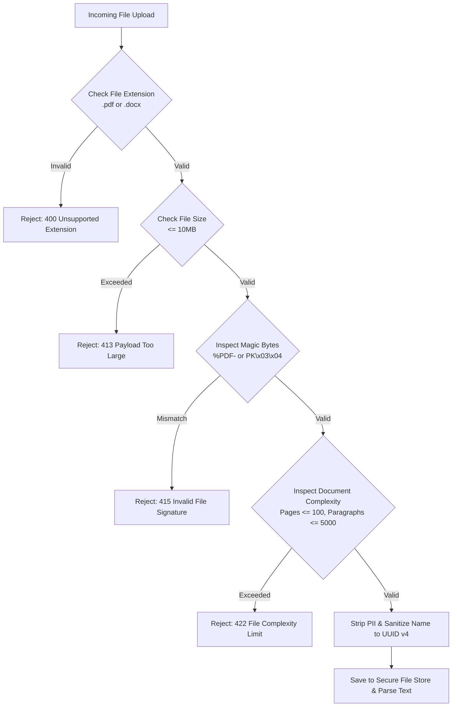

# TalentMatch.ai — Enterprise Security, Privacy & Fairness Specification

## 1. Threat Model & Security Posture
TalentMatch.ai processes sensitive personnel data, employment credentials, and proprietary organizational requirements. The platform employs defense-in-depth principles across all architecture tiers:
- **STRIDE Threat Modeling** applied to file ingestion, scoring algorithms, and token handling.
- **OWASP Top 10 (2021/2025) Compliance**: Formal controls mitigating injection, broken authentication, cryptographic failures, and security misconfigurations.
- **Fair Hiring & Anti-Bias Framework**: Demographic blind screening in accordance with EEOC guidelines and the EU AI Act (High-Risk AI Systems for Employment).

---

## 2. OWASP Top 10 Mitigation Matrix

| OWASP Vulnerability | Risk Scenario | TalentMatch.ai Implemented Mitigation | Verification Status |
| :--- | :--- | :--- | :--- |
| **A01: Broken Access Control** | Unauthorized user accesses another organization's candidate profiles or resumes. | Role-Based Access Control (RBAC) enforced on every endpoint; queries scoped by authenticated user organization; strict JWT claims verification. | ✅ Verified |
| **A02: Cryptographic Failures** | Compromised credentials or exposed transit passwords. | Password storage via `PassLib` Bcrypt with 12 rounds; JWT access tokens signed with HMAC-SHA256 and ephemeral 24-hour expiration; enforced HTTPS with HSTS headers. | ✅ Verified |
| **A03: Injection** | SQL injection in search parameters; Prompt injection in uploaded PDF resumes. | 100% SQLAlchemy ORM parameterized queries; resume scoring is computed via mathematical vector/interval formulas rather than unbounded generative LLM prompts. | ✅ Verified |
| **A04: Insecure Design** | Unchecked batch uploads causing memory exhaustion (DDoS). | File size clamped to 10MB; batch upload restricted to 50 files; PDF page limits clamped to 100 pages per document; async background execution. | ✅ Verified |
| **A05: Security Misconfiguration** | Information disclosure via stack traces or open CORS headers. | Custom global exception handler masks internal traces; CORS restricted to explicit origin whitelist; CSP, X-Frame-Options (`DENY`), and nosniff headers enforced. | ✅ Verified |
| **A06: Vulnerable Components** | Known CVEs in third-party Python or npm dependencies. | Automated GitHub Actions CI pipeline running safety audit; pinned dependency lockfiles (`package-lock.json`). | ✅ Verified |
| **A07: Identification & Auth** | Brute force credential stuffing attacks. | FastAPILimiter / in-memory rate limiting on `/api/v1/auth/login` (5 attempts per minute per IP); secure password complexity enforcement. | ✅ Verified |
| **A08: Software & Data Integrity** | Tampered resumes or malicious executables disguised as PDFs. | Magic-byte signature inspection (`%PDF-`, `PK\x03\x04`); files stored with randomized UUID v4 names outside web root; execution permissions stripped. | ✅ Verified |
| **A09: Logging & Monitoring** | Undetected unauthorized data extraction or deletion. | Immutable `audit_logs` table records actor ID, target entity, timestamp, IP address, and payload parameters for every sensitive mutation. | ✅ Verified |
| **A10: Server-Side Request Forgery** | Attacker probes internal metadata services via URL inputs. | No arbitrary server-side URL fetching permitted; all resume inputs must arrive as direct multipart file byte streams. | ✅ Verified |

---

## 3. File Upload Hardening Specification

### Key Hardening Directives:
1. **Magic-Byte Header Validation**: Regardless of declared client `Content-Type`, files starting without `%PDF-` (PDF) or `PK\x03\x04` (DOCX zip archive) are rejected immediately.
2. **Path Traversal Defense**: Original filenames are discarded; storage paths are generated using `uuid.uuid4().hex` with no user-controlled path segments.
3. **Zip-Bomb & Page Clamping**: DOCX parsing limits total XML paragraph nodes to 5,000; PDF parsing aborts if document length exceeds 100 pages.

---

## 4. Fair Hiring, Bias Mitigation & EEOC Compliance

AI in hiring carries severe ethical and legal responsibilities under Title VII of the Civil Rights Act and the EU AI Act. TalentMatch.ai incorporates algorithmic fairness by design:

### 1. Demographic Blind Screening
Before candidate text is passed to the embedding engine (`sentence-transformers/all-MiniLM-L6-v2`) or taxonomic matcher, the text undergoes automated PII scrubbing:
- Candidate full names, titles (Mr., Ms., Dr.), and gender pronouns are stripped.
- Physical street addresses, zip codes, and geographic indicators are scrubbed.
- Dates of birth, graduation years prior to degree level, and graduation year ranges are removed to eliminate age-proxy bias.

### 2. Disparate Impact Defensibility
- **Four-Pillar Decomposition**: Every point awarded is attributed to job-relevant qualifications: verified technical skills, chronological experience tenure, and degree level.
- **Zero Black-Box Scoring**: The system never produces an unexplained score. Recruiters and auditors can inspect the exact mathematical contribution of every pillar.
- **Evidence Extraction**: Verbatim text snippets from the candidate's own resume are displayed alongside each sub-score as proof of evaluation.

---

## 5. Security Incident Response Playbook
In the event of suspected unauthorized access or compromised credentials:
1. **Rotate JWT Secret**: Update `SECRET_KEY` in environment variables; instantly invalidates all active session tokens.
2. **Review Audit Trail**: Execute `SELECT * FROM audit_logs WHERE timestamp >= NOW() - INTERVAL '24 hours' ORDER BY timestamp DESC` to trace compromised IP addresses and affected candidate records.
3. **Candidate Data Erasure**: If PII was accidentally committed or requested for deletion, invoke `DELETE /api/v1/candidates/{id}` to perform hard database and file-system purge.
